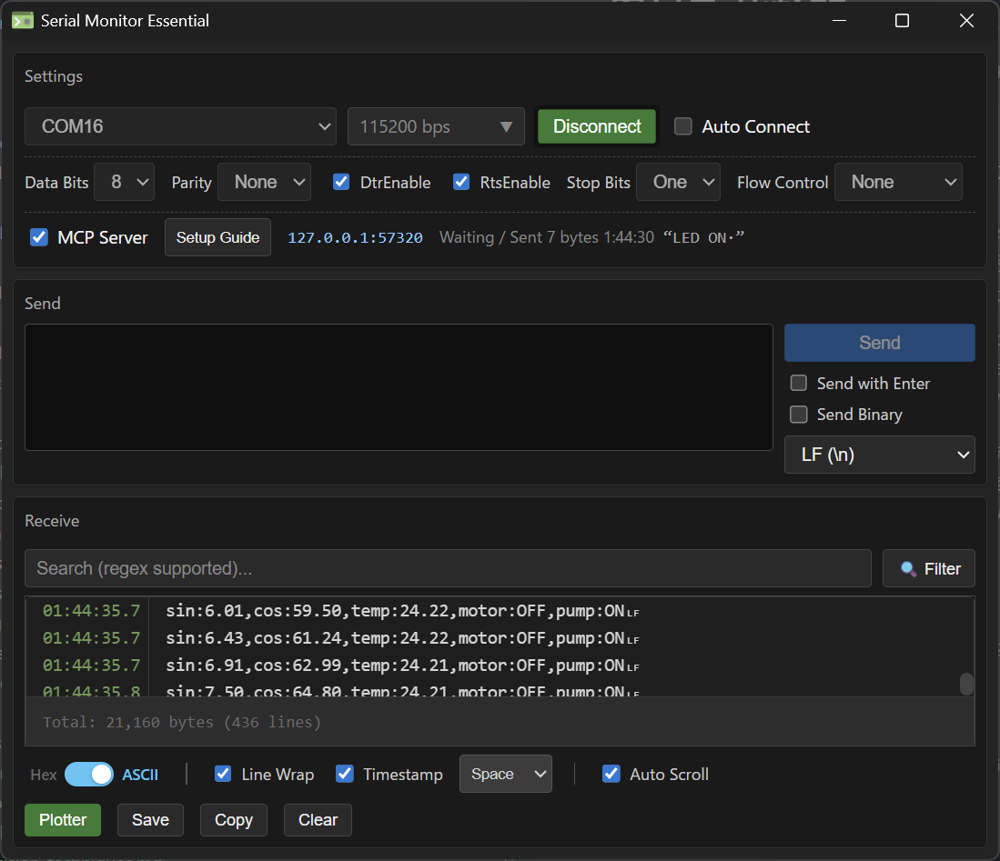
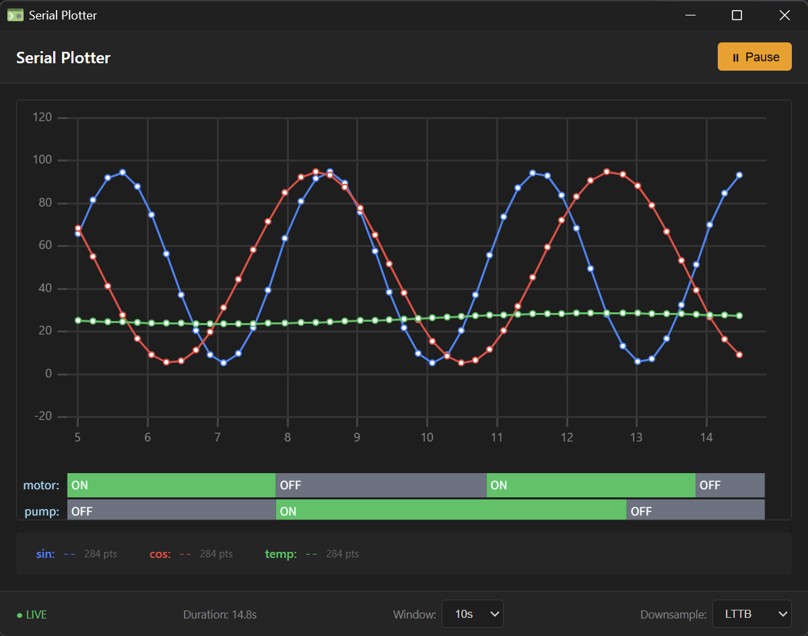
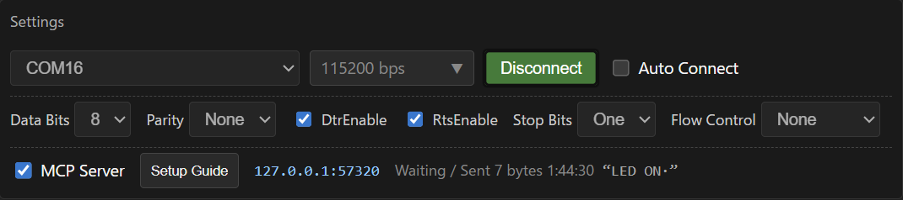

# Serial Monitor Essential

[](https://github.com/771-8bit/SerialMonitorEssential/actions/workflows/ci.yml)
[](LICENSE)

A serial monitor and real-time plotter for fast serial links (tested at 12 Mbaud), with a
built-in **MCP server** so an AI agent such as Claude Code can read and write the same serial
session you are watching.



## Why

When I debug embedded boards I want four things from one window: a monitor that keeps up with
a fast UART without dropping bytes, a plotter that shows numbers *and* states on one time
axis, a capture that survives the board resetting, and — lately — a way to let an AI agent
look at the same log and type into the same port while I watch. I could not find one tool that
did all of that, so I built this one. It is a Tauri/Rust rewrite of an earlier C# version.

## Features

### Monitor

- Lossless receive at high line rates: data is kept in fixed-size chunks and spilled to disk,
  so long captures do not grow memory without bound
- Hex / ASCII views with virtual scrolling, timestamps, line wrap and visible control characters
- Regex search and filter over the whole capture
- Send text or hex, with a selectable line ending (none / CR / LF / CRLF) and input history
- Any baud rate the driver accepts (including non-standard ones), DTR / RTS control, hardware
  or software flow control
- **Auto Reconnect**: when the board resets or is unplugged and comes back on the same port, the
  app reopens it and keeps adding to the same capture, so the output from before the reset is
  not lost
- Save the capture as a binary file, or copy it as hex or ASCII

### Plotter



- Oscilloscope-style roll mode with a fixed window (1 s – 300 s). Downsampling is aligned to
  absolute time, so history does not shift as new data arrives
- **Peak** downsampling (default) draws the minimum and maximum of every pixel column at the times
  they occurred, like an oscilloscope's peak detect: a single-sample spike keeps its real height
  in any window. **Average** draws the mean with a min/max band
- State timeline: non-numeric values such as `motor:ON` are drawn as colored bars on the same
  time axis as the numeric channels
- LIVE / Inspect / Paused: zooming switches to Inspect, you can pan back through history, and
  **LIVE** resumes following
- Arduino-style input — no configuration needed:

  ```text
  25.5,60,RUNNING                        # CSV (channels are named ch0, ch1, ...)
  temp:25.5,humidity:60,state:RUNNING    # label:value pairs
  temp,humidity,state                    # an optional header row names the CSV columns
  ```

### AI integration (MCP)

- A serial port can only be opened by one program at a time, so the app shares the port it
  already has open with the agent instead of making them compete for it
- One-call request/response: `serial_send("AT+GMR", expect="OK|ERROR")` sends and waits for the
  reply, and cannot miss a reply that arrives immediately
- Summaries that stay small: `serial_digest` / `serial_watch` answer from an index, so the reply
  is the same size whether the device sent 4 KB or 4 GB
- Every byte the agent sends is shown in the main window
- Off by default, and listens on `127.0.0.1` only

## Installation

Installers are attached to each release on the
[Releases](https://github.com/771-8bit/SerialMonitorEssential/releases) page. Version 0.1.0 is
the first release of the Tauri/Rust version; tags up to `v0.0.8` are the old C# version.

### Windows 10 / 11 (x64)

1. Download `serial-monitor-essential_<VERSION>_x64-setup.exe` and run it. It installs for the
   current user only, so no administrator rights are needed.
2. The installer is not code-signed, so SmartScreen may warn about it. Click **More info** →
   **Run anyway**. The release page shows the SHA-256 of each file next to it if you want to
   verify the download.

If you used the old C# version (0.0.9 or earlier), both versions can be installed side by side
and the old one is left untouched. Uninstall it from **Settings → Apps** to avoid confusion.

### Ubuntu 22.04+ (x64)

```sh
# .deb (recommended; apt installs webkit2gtk-4.1 and the other dependencies)
sudo apt install ./serial-monitor-essential_<VERSION>_amd64.deb

# or the AppImage
chmod +x serial-monitor-essential_<VERSION>_amd64.AppImage
./serial-monitor-essential_<VERSION>_amd64.AppImage
```

Serial devices (`/dev/ttyUSB*`, `/dev/ttyACM*`) belong to the `dialout` group. Add yourself once,
then log out and back in:

```sh
sudo usermod -aG dialout $USER
```

### macOS

Not supported. The code compiles on macOS in CI, but nothing is tested there and no binaries are
published.

## Quick start

1. Pick a port and a baud rate, then click **Connect**.
2. Received data appears under **Receive**. Switch between **Hex** and **ASCII**, or type a regex
   into the search box.
3. Type into **Send** and press **Send** (or turn on **Send with Enter**).
4. Click **Plotter** to open the plotter. Channels are created automatically from the incoming
   lines.

## Using it with an AI agent (MCP)



1. Turn on **MCP Server** in the settings panel. It listens on `127.0.0.1:57320`.
2. Register the app as an MCP server in your AI client. The MCP server is built into the app
   itself, so nothing else needs to be installed. **Setup Guide** (next to the toggle) shows
   the exact command for your install path. With Claude Code:

   ```sh
   # Windows
   claude mcp add serial-monitor -- "<path-to>\serial-monitor-essential.exe" --mcp

   # Linux (.deb)
   claude mcp add serial-monitor -- /usr/bin/serial-monitor-essential --mcp
   ```

   Other MCP clients take the same command in their `mcpServers` JSON:
   `"command": "<path-to-exe>", "args": ["--mcp"]`.

3. Ask for what you need:

   ```text
   You    : Send AT+GMR to the board and tell me the firmware version.
   Claude : serial_send("AT+GMR", expect="OK|ERROR")
            → "AT version:2.1.0.0 ... OK". The firmware version is 2.1.0.0.
   You    : Check the recent log for CRC errors.
   Claude : serial_find("CRC mismatch") → 3 matches (offsets 12034, 40881, 91002)
   You    : What is this board doing?
   Claude : serial_digest() → 402,331 lines in 6 shapes, 0 err / 3 warn,
            one new line "W: rx overflow q=64" first seen at offset 134,110,221
   ```

The app has to be running with **MCP Server** on while the agent works. If it is not, the tools
return an error that says so, rather than failing silently.

| Tool | What it does |
| --- | --- |
| `serial_status`, `serial_ports` | Connection state, port list |
| `serial_digest`, `serial_watch` | Summary of the whole capture / what changed since last time |
| `serial_sample`, `serial_find` | Representative lines, regex search |
| `serial_read_tail`, `serial_read_range` | Raw bytes from the end / from any offset |
| `serial_send`, `serial_send_hex` | Send text or bytes, optionally waiting for a reply |
| `serial_wait_for` | Wait for a regex to match new data |

Details, environment variables and the full tool reference: [`mcp/README.md`](mcp/README.md).

**Without MCP:** any program can connect to `127.0.0.1:57320` directly and exchange one JSON
object per line. Send `{"id":1,"method":"help"}` first to get the machine-readable protocol
specification.

**Security.** While **MCP Server** is on, any program running on the same computer can connect
to the port, read the capture and send to the device. Remote machines cannot connect, and
nothing the agent sends is hidden from you. Do not turn it on if you do not trust the other
programs on that computer.

## Measured performance

| What | Result | Setup |
| --- | --- | --- |
| Receive at line rate | 60 s at 12 Mbaud, **0 bytes lost** | FT232H loopback with RTS/CTS flow control, while also sending 64 KiB blocks |
| Plotter memory | Flat after warm-up (about 210 MB) | 60 s of continuous plotting |
| MCP summary size | `serial_digest` ≈ 250 tokens, `serial_watch` ≈ 110 tokens | Independent of how much data has been received |

Without flow control, even a plain USB-serial adapter can drop bytes at these rates, before
the data ever reaches the app. How these were measured is described in the
[V&V plan](docs/24_vv_plan.md) (Japanese).

Performance tests and the end-to-end UI tests run on Windows only. On Linux the build and unit
tests run in CI, plus a smoke test under WSL2. Wayland and HiDPI have not been tested.

## Building from source

Prerequisites: Node.js 20+, stable Rust, and the
[Tauri prerequisites](https://v2.tauri.app/start/prerequisites/) for your OS.

```sh
npm install
npm run tauri dev       # run in development mode (set RUST_LOG=debug for verbose logs)
npm run tauri build     # build installers into src-tauri/target/release/bundle

# the same checks CI runs
npm run type-check && npm run lint && npm run format:check && npm test
cd src-tauri && cargo fmt -- --check && cargo clippy --all-targets -- -D warnings && cargo test
```

The design and test documents in [`docs/`](docs/) are written in Japanese:
[requirements](docs/21_system_requirements.md) ·
[architecture and ADRs](docs/22_architecture_description.md) ·
[traceability](docs/23_traceability.md) ·
[V&V plan](docs/24_vv_plan.md) ·
[release strategy](docs/25_release_strategy.md) ·
[AI API design](docs/26_ai_api_design.md) ·
[open verification items](docs/27_open_verification.md).
The end-to-end UI test harness (com0com + Windows UI Automation) is in
[`test_tools/e2e/`](test_tools/e2e/README.md).

Bug reports and pull requests are welcome. Please open an issue first for larger changes.

## License

[MIT](LICENSE)
